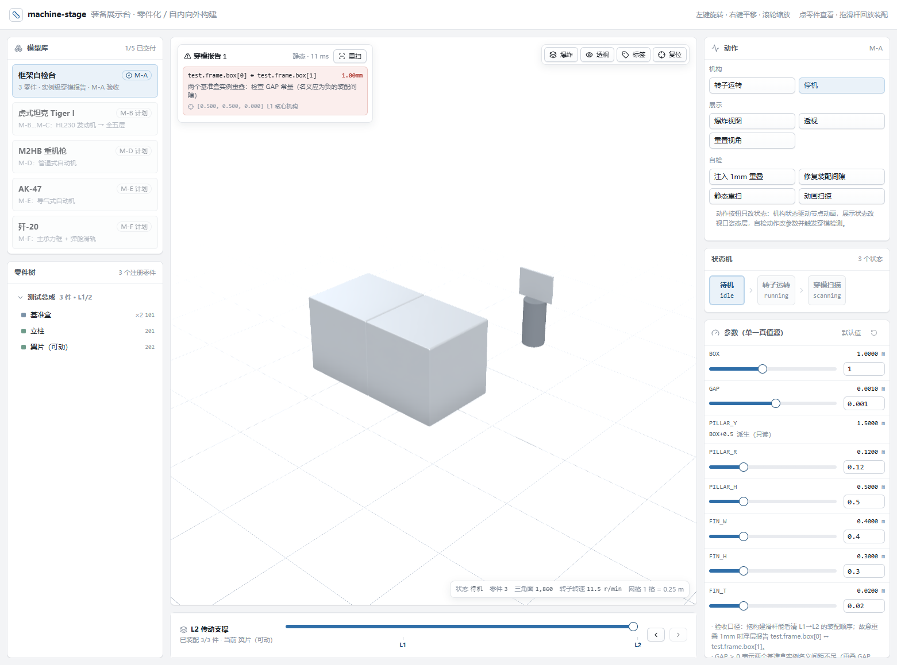
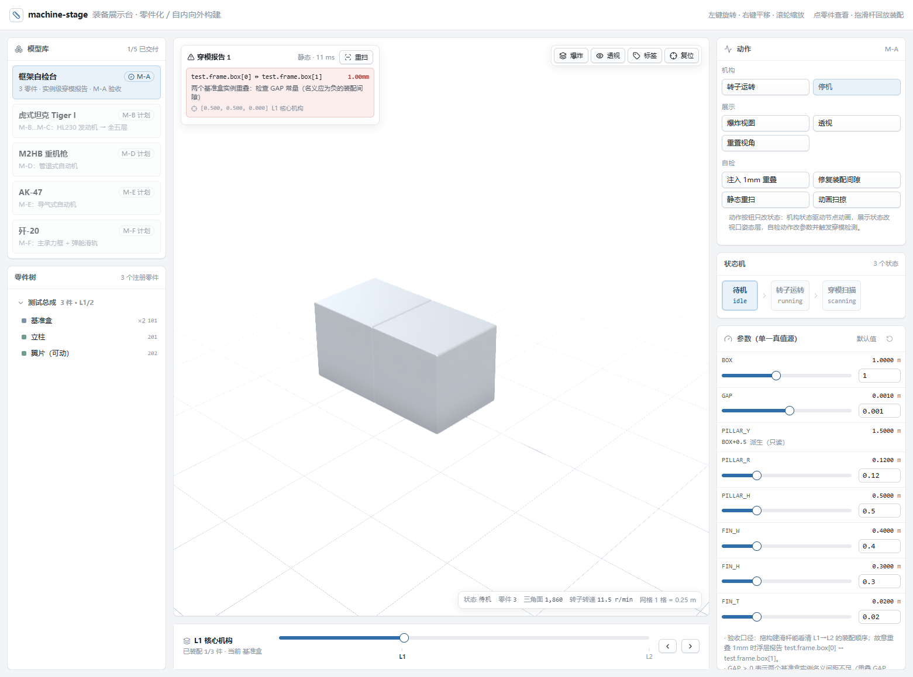

# machine-stage · 装备展示台

**纯前端 3D 军工装备展示台**：零件化程序化建模（无外部模型资产）+ **自内向外构建**（L1 核心机构 → L5 表面附件）+ **实例级穿模检测** + **构建进度回放**。

每个零件都在注册表里有名字、有层号、有装配关系；每一条穿模报告都指到具体实例（`tiger.track.link[42] ↔ tiger.suspension.roadwheel[7]`）。



---

## 现在能做什么（M-A 框架底座已交付）

| 能力              | 说明                                                                                                                       |
| ----------------- | -------------------------------------------------------------------------------------------------------------------------- |
| **零件化注册表**  | `<model>.<assembly>.<part>[index]` 命名；坐标全部由 `constants` + `mate` 派生，无匿名 mesh 流水账                          |
| **装配器**        | 注册表 → 场景树：节点树、双侧件展开、锚点/同轴装配、实例布局、构建阈值                                                     |
| **穿模检测器**    | AABB 粗检 + three-mesh-bvh 精检；**实例级**报告带 `depth_mm / point / hint`；支持静态、动画扫掠（≥30fps 采样）与层验收过滤 |
| **构建进度滑杆**  | 按 `build_order` 逐件展开，从单件核心机构一层层装到整车                                                                    |
| **三栏展示台 UI** | 左：模型库 + 零件树；中：视口 + 构建滑杆 + 穿模浮层；右：动作 / 状态机 / 参数（单一真值源）                                |
| **视口**          | 轨道相机、总成标签、爆炸视图、透视、零件聚焦与高亮；程序化 studio 环境 + ACES + SSAO（无 HDR 资产依赖）                    |



## 快速开始

```bash
npm install
npm run dev        # http://localhost:5173
```

| 命令                              | 作用                                    |
| --------------------------------- | --------------------------------------- |
| `npm run dev`                     | 开发服务器                              |
| `npm run build`                   | 类型检查 + 生产构建（`dist/`）          |
| `npm run preview`                 | 预览生产构建                            |
| `npm test`                        | 单元测试（vitest，node + jsdom 双环境） |
| `npm run test:watch`              | 监听模式                                |
| `npm run test:coverage`           | 覆盖率                                  |
| `npm run typecheck`               | `tsc --noEmit`                          |
| `npm run lint`                    | ESLint                                  |
| `npm run format` / `format:check` | Prettier                                |

## 自检台（M-A 验收场景，默认加载）

`框架自检台` 是一张只有 3 个零件、2 个实例的测试注册表，专门用来验收框架：

1. **实例级报告**：`基准盒` 两个实例的名义间距由 `GAP` 决定，`GAP > 0` 即重叠 → 浮层出现 `test.frame.box[0] ↔ test.frame.box[1] 1.00mm`，并提示「检查 GAP 常量」。
2. **参数闭环**：右栏点「修复装配间隙」（`GAP = -0.002`）→ 重建 → 报告清空 → 浮层显示「实例级穿模报告为空」。
3. **动画扫掠**：点「转子运转」让 `TestRotor` 节点转起来，再点「动画扫掠」→ 30fps 逐帧采样检测，结果同样按实例给报告。
4. **构建回放**：拖构建滑杆，模型从 L1 核心机构一件件长出来；`立柱` 抬高时，贴在它顶面上的`翼片` 通过锚点装配自动跟随（改常量不改坐标）。

## 里程碑

| 里程碑  | 内容                                                                             | 状态                              |
| ------- | -------------------------------------------------------------------------------- | --------------------------------- |
| **M-A** | 框架底座：装配器 + 穿模检测器 + 构建滑杆 + 展示台 UI                             | ✅ 已交付                         |
| **M-B** | 虎式坦克 L1：HL230 V12 发动机（缸体 / 曲轴 / 活塞 / 双风扇）+ 求解器联动         | ⏳ 进行中                         |
| **M-C** | 虎式全五层（L2 传动支撑 → L5 表面附件），每层过验收才进下一层                    | ⏳                                |
| **M-D** | M2HB 重机枪（管退式自动机）                                                      | ⏳                                |
| **M-E** | AK-47（导气式自动机）                                                            | ⏳                                |
| **M-F** | 歼-20（主承力框 + 弹舱滑轨）                                                     | ⏳                                |
| **M-G** | 金古桥 King Joe：编队变换 / 四体分离合体 / 阻尼对接 / 合成音效 / 重踏步 / 怪光线 | ✅ 已交付（578 件 / 全程 0 穿模） |

详细进度、每层验收证据见 [`docs/PROGRESS.md`](docs/PROGRESS.md)。

## 目录结构

```
src/three/parts/
  registry/    注册表：types（数据格式）/ expression（常量表达式）/ validate（校验）/ testKit（自检台）
  assembler/   装配器：geometry（声明 → BufferGeometry）/ assembler（注册表 → 场景树）
  solver/      report（报告格式与提示）/ detect（静态 + 扫掠检测）
  kernel/      几何与贴图工具箱（倒角盒 / 放样 / 铆钉 / 三联贴图 / 材质库）
src/app/       UI：catalog（模型清单）/ state（zustand）/ three（视口与姿态层）/ components（三栏面板）
docs/          设计基线文档（总体设计 / 零件化建模框架 / MACHINE_STYLE / 真实感指南）
```

## 文档

| 文档                                                       | 内容                                                          |
| ---------------------------------------------------------- | ------------------------------------------------------------- |
| [`docs/ARCHITECTURE.md`](docs/ARCHITECTURE.md)             | 分层、数据流、mate/实例布局语义、检测算法、扩展新机的标准动作 |
| [`docs/PROGRESS.md`](docs/PROGRESS.md)                     | 里程碑进度、每层验收证据、已知边界                            |
| [`docs/展示台项目总体设计.md`](docs/展示台项目总体设计.md) | 总规格（里程碑、UI、验收口径）                                |
| [`docs/零件化建模框架.md`](docs/零件化建模框架.md)         | 注册表 / 命名 / 穿模报告格式基线                              |
| [`docs/MACHINE_STYLE.md`](docs/MACHINE_STYLE.md)           | 视觉规范与红线（§6 剖切、§9 视觉红线）                        |
| [`CONTRIBUTING.md`](CONTRIBUTING.md)                       | 开发流程、门禁、建模与提交约定                                |
| [`CHANGELOG.md`](CHANGELOG.md)                             | 版本变更记录                                                  |

## 设计纪律（不可协商项）

- **真实米制**：所有尺寸单位是米，来自公开资料近似值并注明出处；单一真值源是注册表 `constants`。
- **禁止匿名 mesh**：一切零件来自注册表，一切坐标来自 `constants` / `mate` 派生。
- **实例级报告**：`a` / `b` 必须是 `零件ID[实例下标]`。
- **自内向外**：先核心机构，再包壳；一层零穿模才进下一层。
- **视觉红线**：最小可见单元 ≤0.35m、曲面用放样/Lathe、微倒角、面板三联贴图、SSAO + ACES 必开（见 `docs/MACHINE_STYLE.md` §9）。

## 已知边界

- 剖切（带实心端盖的剖面）按 `MACHINE_STYLE` §6 要求实现，随 M-C 交付；当前未提供半成品按钮。
- 穿模检测目前同步执行（自检台 ~10ms）；整车级模型计划移入 Web Worker。
- 高亮到实例级（当前是零件级）随 L2 履带/轮组接入时补齐。

## 许可与致谢

MIT © 2026 OasisMind contributors。几何/贴图工具箱衍生自同作者的 `detailKit.ts`，署名见 [`THIRD_PARTY_NOTICES.md`](THIRD_PARTY_NOTICES.md)。三方依赖：three.js、@react-three/*、three-mesh-bvh、Zustand、lucide-react。
