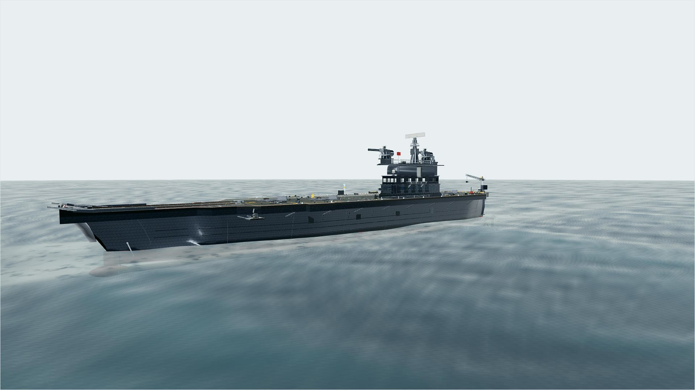
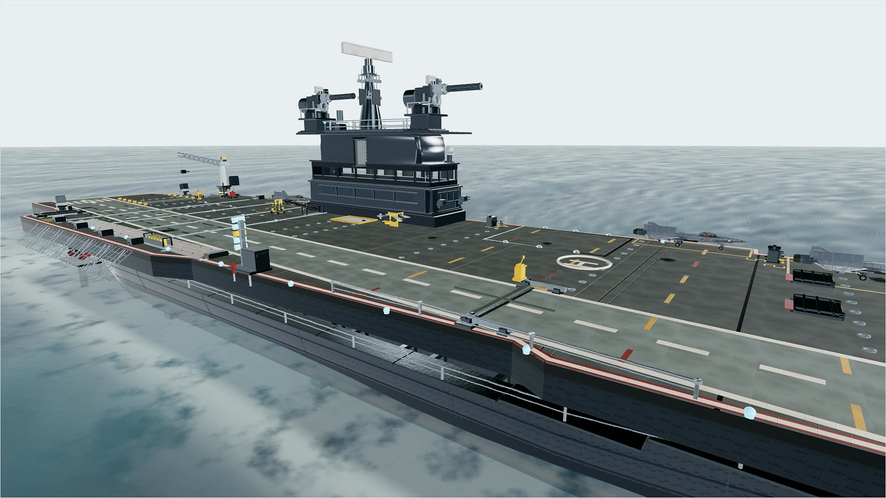
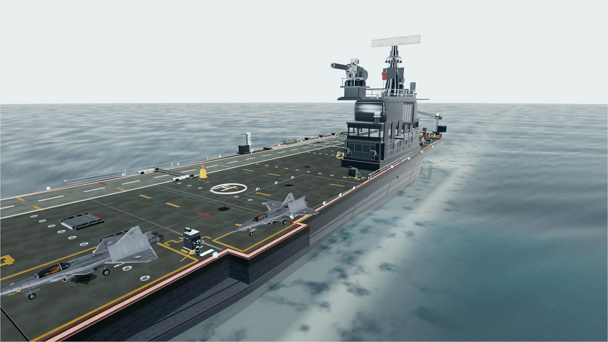
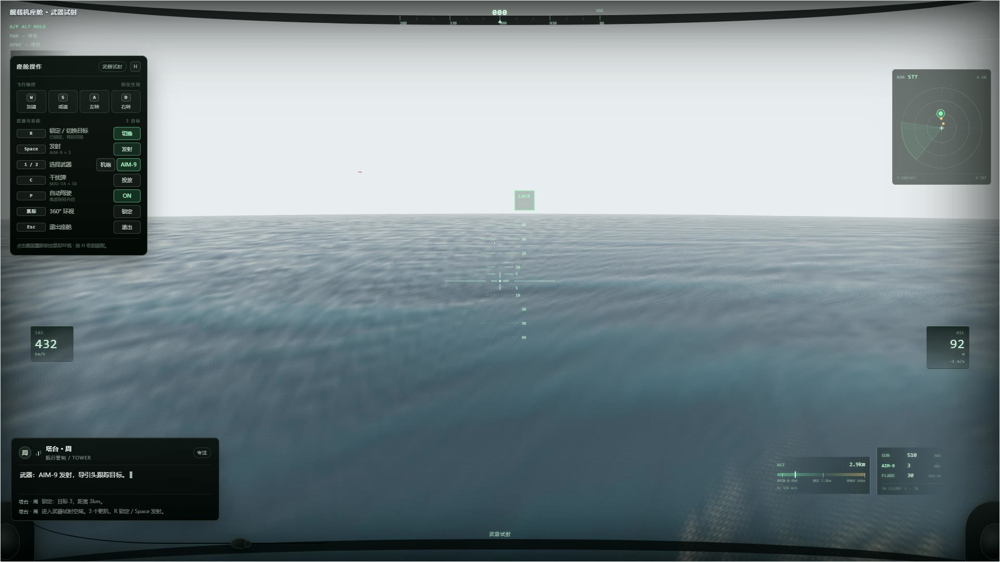
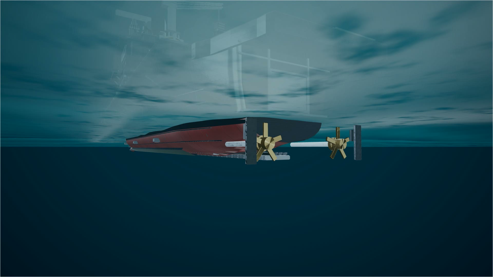
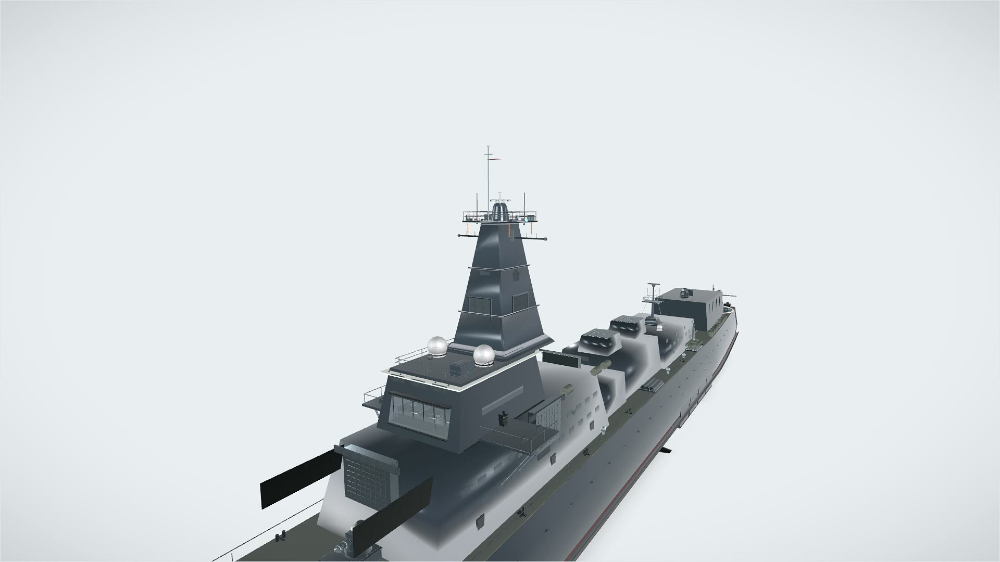
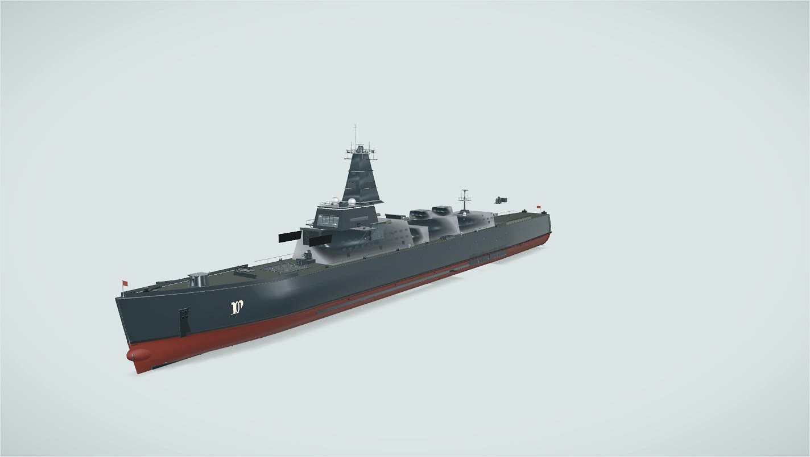

# machine-stage · 展示图

实时 Three.js 场景截图（1920×1080，非离线渲染）。福建舰、055 型驱逐舰，以及舰载机座舱/海战系统和水下视角。

技术栈：React 19 · Three.js · React Three Fiber · Zustand · Vite

## 福建舰 · 全舰



## 飞行甲板与舰岛



## 甲板 J-20



## 舰载机座舱 · 武器试射

航向带 / 俯仰梯 / IAS·ASL / 火控雷达 / WEZ / RWR，以及锁定、AIM-9 发射、干扰弹、自动驾驶和 360° 环视。



## 水下视角

从舰底仰视，双轴、五叶可调距桨和舵。水下不是一张平面：水面内侧、深水雾、海床沙脊与焦散、悬浮海雪和从水面斜射的光束共同组成水体；相机可直接从水上拖到水下环视。



## 055 · 一体化桅杆

切角八棱主桅、桅顶收口/导航雷达/旗杆、舰桥顶栏杆、后桅与卫通，按公开照片轮廓重做。



## 055 型驱逐舰

11,972 个注册零件；112 单元垂发、346B 四面阵、130mm 主炮、1130 近防、双机库与直-20。



## 本地运行

```bash
npm install
npm run dev
# http://localhost:5174
```

## 说明

- 截图中的模型、海面、座舱 HUD、雷达和武器状态均由应用实时生成。
- 参考照片只用于轮廓与比例对照，不进入模型贴图；来源与许可见 `docs/qa/refs/055/CREDITS.md`。
